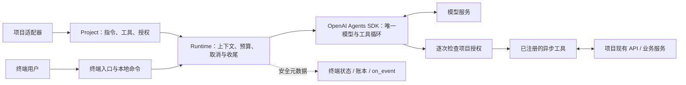
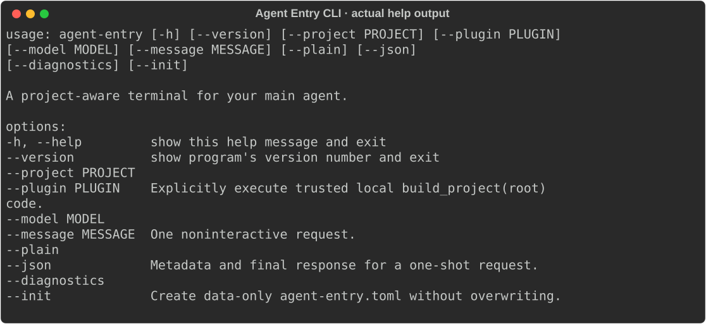
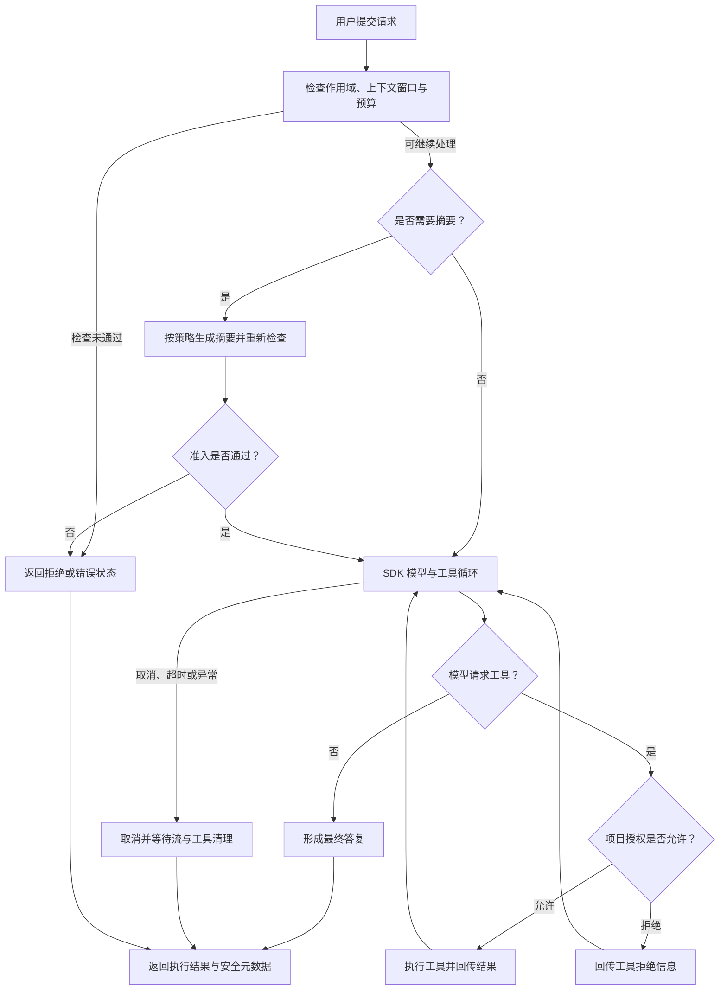
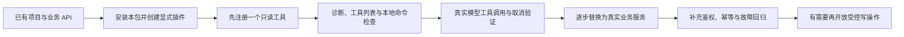
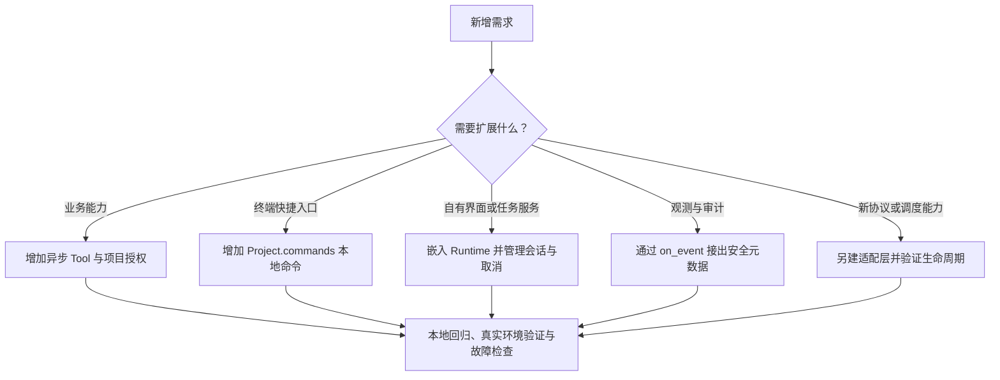

<div align="center">

# 🧭 Agent Entry CLI

**通过少量 Python 接入，为现有项目提供主 Agent 终端入口。**


流式输出 · 上下文摘要 · 显式项目工具 · 安全会话控制

[官方主页](https://xsoway.github.io/agent-entry-cli/) · [离线预览](index.html) · [中文快速入门](README.zh-CN.md) · [接入说明](docs/integration.md) · [架构与边界](docs/architecture.md)

</div>

## 目录

[开发初衷](#为什么开发独立的-agent-cli) · [职责架构](#整体如何协作) · [工具对比](#与-codexpiopencodeclaude-code-有什么区别) · [安装](#环境要求与安装) · [配置](#配置) · [运行](#运行) · [接入](#接入你的项目) · [扩展](#后续如何扩展) · [常见问题](#常见问题) · [开发检查](#开发检查) · [维护与发布](#维护与发布)

## 为什么开发独立的 Agent CLI？

一个已有的 Python 项目，可能已经具备知识检索、评测、状态查询或其他业务服务。接入 Agent 时，需要把这些服务组织成可对话的工具，并处理连续提问、取消、上下文压缩、授权与执行记录。每个项目分别实现一遍终端和会话管理，会增加重复代码，也容易把交互逻辑与业务规则耦合在一起。

**Agent Entry CLI 的初衷，是把这些通用入口能力拆成独立 Python 包，让项目继续拥有业务实现和权限判断。** 项目提供根目录、指令、异步工具和授权回调；库提供终端、会话生命周期和安全执行元数据。多个项目可以复用同一个入口，各自保留不同的工具和规则。

独立主要体现在三个方面：

- **业务独立：** 本包不导入特定应用的 Core，不把评测、知识库或运维平台的流程固化为公共 API。示例适配器可以调用原应用，正式业务状态和审批仍由原应用负责。
- **入口可嵌入：** 既可以运行 `agent-entry --plugin ...`，也可以在自己的 Python 程序里调用 `run_cli(project)`；需要无界面执行时使用 `Runtime`。
- **职责明确：** 模型／工具循环复用 OpenAI Agents SDK；本库负责项目接入、上下文准入、取消收尾和元数据展示；项目负责真实业务操作、权限、幂等与结果核实。

这里的“独立”指业务解耦和入口可复用。当前是 Alpha 阶段，首个后端依赖 OpenAI Agents SDK，模型服务需要单独配置。

| 接入任务 | 项目通常需要自行处理 | 本包提供 |
|---|---|---|
| 启动项目主助手 | 终端输入、输出和命令处理 | 感知项目的终端与可嵌入入口 |
| 持续多轮对话 | 窗口检查、摘要、恢复和用量跟踪 | 统一生命周期与显式摘要检查点 |
| 添加业务工具 | 把服务 API 暴露给模型，并核对业务权限 | 异步 `Tool` 与逐次调用的项目授权回调 |
| 处理中断和后续输入 | 流清理、队列、失败后的状态恢复 | 取消收尾、暂停队列与明确的执行状态 |
| 排查 Agent 执行 | 对应模型调用、工具阶段、上下文和用量 | 带执行 ID 的元数据、状态展示与 `on_event` 回调 |

## 整体如何协作？



项目适配器负责连接真实业务与权限；本库负责入口与生命周期；SDK 负责模型与工具循环。`on_event` 是项目接出观测数据的接口，尚未内置外部观测平台。

## 与 Codex、Pi、OpenCode、Claude Code 有什么区别？

以下比较聚焦**产品定位、接入方式和项目需要承担的职责**，不是模型能力、速度或安全性的排名。这里的 Pi 指 Pi Agent harness，Claude 指 Claude Code；不是普通聊天产品。外部能力依据 2026-10-24 查阅的官方资料，具体接口以所用版本为准。

### 先看它们分别适合什么

| 工具 | 主要定位 | 扩展与程序化接入 | 更适合的需求 |
|---|---|---|---|
| [Codex CLI](https://learn.chatgpt.com/docs/codex/cli) | 面向软件开发的 Agent，可检查代码、修改文件和运行命令 | [Codex SDK / App Server](https://learn.chatgpt.com/docs/codex-sdk)、非交互执行，以及扩展能力 | 直接开展代码开发、审查和工程自动化；需要复用 Codex harness 构建应用 |
| [Pi](https://github.com/earendil-works/pi/blob/main/packages/coding-agent/README.md) | 精简、可扩展的终端 Agent harness | 扩展、Skills、提示模板、交互／JSON／RPC 及 TypeScript SDK | 希望在可定制 harness 上组织自己的 Agent 工作流 |
| [OpenCode](https://opencode.ai/docs/) | 开源 AI 编程 Agent，提供终端等使用入口 | 自定义工具、MCP、权限配置及 [JS/TS SDK（调用 OpenCode 服务）](https://opencode.ai/docs/sdk/) | 使用已有编程工具链，并通过 OpenCode 的服务和扩展接口集成 |
| [Claude Code](https://code.claude.com/docs/en/overview) | 面向代码库、文件修改和命令执行的开发助手 | [非交互 CLI 与 Python / TypeScript Agent SDK](https://code.claude.com/docs/en/headless) | 使用 Claude Code 的工具、Agent loop 和上下文管理做开发或自动化 |
| **Agent Entry CLI** | **为现有 Python 项目提供终端主助手入口** | `Project`、异步 `Tool`、`authorize`、`run_cli`、`Runtime`、显式 Python 插件 | 已有业务服务和规则，希望直接注册 Python 函数，并复用一套范围明确的终端与会话控制 |

这些工具都可以用于自定义集成。尤其 Pi 已提供可嵌入 SDK，Codex、OpenCode 和 Claude Code 也提供程序化入口；“能接业务工具”和“能嵌入应用”并非本项目独有的能力。

本库通过 OpenAI Agents SDK 接入模型服务，运行时不封装或启动 Codex、Pi、OpenCode、Claude Code 的 CLI，也不依赖它们的 SDK。

本项目的具体选择是：**把已有 Python 业务函数作为工具入口，把项目授权回调作为逐次业务检查入口，终端随库一起复用。** 如果你的目标是复用某个现成 harness 的工具生态和执行能力，其官方 SDK 或扩展机制也应纳入选型。

### 再看本项目的设计取舍

| 维度 | Agent Entry CLI 的当前做法 | 对使用者的影响 |
|---|---|---|
| 默认操作能力 | 默认纯聊天；业务工具显式注册，没有内置文件编辑或 shell 工具 | 需要项目自己提供可执行能力，安装后不会自动成为编程助手 |
| 集成边界 | 可信 Python 插件或进程内 `Project`；不自动发现并执行项目插件 | 可直接复用现有 Python 服务；其他语言通常需要自行提供适配 API 或进程边界 |
| 权限与写操作 | 声明写工具默认拒绝；每次调用都交给项目策略检查 | 适合承接已有业务门禁；仍需项目实现真实鉴权、幂等和外部状态核实 |
| 安全隔离 | 插件与宿主进程共享用户权限，只读声明不构成沙箱 | 需要隔离时应另选经过验证的沙箱、容器或操作系统方案；不可信代码需单独处理 |
| Loop 与 Harness | SDK 拥有唯一模型／工具循环，本库增加预算、取消、清理与日志约束 | 避免业务项目分别实现终端循环；仍受 SDK 和插件取消协作能力的约束 |
| 上下文与恢复 | 指令、工具 schema、历史和预留共同参与窗口判断；显式保存摘要并校验项目作用域 | 可保留任务目标和约束；检查点不等于完整对话回放，也不能恢复工具授权 |
| 可观测性 | 展示阶段、循环次数、耗时、工具状态和已知／未知用量；提供元数据回调 | 方便项目侧排查和对接观察系统；没有内置完整遥测平台或计费系统，私有推理不进入界面／日志 |
| 模型与协议 | 当前使用 OpenAI Agents SDK 的 Chat Completions / Responses 后端 | 兼容端点需要实际验证；不能把可填写模型名理解为已适配所有供应商 |
| 产品完整度 | 当前提供本地终端、单次请求和嵌入式接口 | 没有内置 IDE、云端任务平台、多 Agent 调度、MCP 客户端或 Skills 加载体系 |
| 成本与维护 | 复用库的通用交互能力；模型调用和业务适配仍由项目承担 | 需要维护插件、权限策略、回归与供应商兼容；不承诺更低 token、价格或更高性能 |

选择自建入口，需要接受相应维护责任。这里的价值在于让业务边界与 Python 集成方式更贴合项目，而不是减少所有工程工作。

## 可以用来做什么？

| 场景 | 交互示例 | 本仓库的支持情况与项目职责 |
|---|---|---|
| 知识查询助手 | “查找部署时间窗口，并给出笔记文件与行号。” | 已提供 [knowledge 示例](examples/knowledge/README.md)，执行有范围限制的只读笔记搜索；真实知识源与访问控制由项目接入 |
| 评测流程助手 | “查看这个评测工作区目前处于哪个阶段。” | 已提供 [eval-harness 示例](examples/eval-harness/README.md)，只调用已安装 CLI 查询状态；不代为审批或执行评测 |
| 运维／服务状态助手 | “查询服务健康状态，说明哪些检查未通过。” | 可通过异步工具连接现有只读 API；实际监控、工单和运维系统尚未内置 |
| 受控业务操作入口 | “在项目规则允许的条件下执行某项操作。” | 可注册 `side_effect=True` 的工具并提供 `authorize`；业务鉴权、确认、幂等、补偿和审计需项目实现，不提供通用审批 UI |
| Agent 行为与接入验证 | “观察工具循环、取消、上下文压缩和用量缺口。” | 可使用 `Runtime`、执行账本和 `on_event` 验证协议及生命周期；业务效果、数据集、Oracle / Judge 与评测报告需另外建设 |

表中“可接入”表示接口支持该用途，不表示已经交付对应的业务系统。当前可运行的具体示例以 `examples/` 和[验收记录](docs/terminal-acceptance.md)为准。

## 什么时候选择它？

- **已经有 Python 服务、领域工具和业务规则，缺少统一的对话入口：** 可以考虑本库，让原项目继续负责业务和授权。
- **主要需求是写代码、改文件、运行工程命令或审查仓库：** 优先评估 Codex、Pi、OpenCode、Claude Code 等现成工具；它们已有相应工具和工作流。
- **需要深度复用某个成熟 harness 的会话、工具和生态：** 先评估其官方 SDK、RPC 或服务端接口，再决定是否需要另建入口。
- **需要不可信代码隔离、完整 IDE／云端产品、多 Agent 调度或统一观测平台：** 当前本库不能独立满足，需要选择已有方案或额外建设。

它也可以与编程 Agent 配合：用现成工具开发、调试项目，用 Agent Entry CLI 承载项目自身的业务助手。两种入口各自遵循实际注册工具与项目权限边界。

## 效果预览

<table>
<tr>
<td width="50%"><br><b>命令行入口</b> · 根据本地实际帮助输出生成</td>
<td width="50%"><br><b>上下文诊断</b> · 本地控制，不调用模型</td>
</tr>
</table>

## 当前能力

- **项目入口：** `Project(root, instructions, tools)` 和 `run_cli(project)`。
- **显式工具：** 异步 Python 工具；声明为写操作的工具每次调用都需要项目授权。
- **流式控制：** Esc 或 `/stop` 停止；普通输入进入下一轮队列，失败后队列暂停。
- **上下文：** 可配置窗口检查，自动／手动结构化摘要，不静默删除最新一轮对话。
- **检查点：** 显式 `/save` 保存，`/resume` 校验项目作用域后恢复；默认不持久化对话原文。
- **诊断：** 模型设置、执行 ID、元数据账本和累计已知／未知用量；价格未知时保持不可用。
- **示例：** 有范围限制的只读笔记搜索，以及可选的现有评测 CLI 状态适配器。

### 一次请求怎样执行？



图中回到 SDK 的箭头表示同一个内层循环。终端可以排队下一条请求；失败或取消后队列暂停，清理未完成时禁止新模型轮次。默认无策略时只允许已声明的读工具，写工具拒绝；配置策略后，每次读写调用都检查策略。未知写结果由项目核实，不自动重放。

## 环境要求与安装

需要 Python **3.13+**、[uv](https://docs.astral.sh/uv/) 和 macOS 或 Linux。当前不支持 Windows。
首个后端使用 OpenAI Agents SDK 0.22.x，支持 Chat Completions 或 Responses API。
请填写供应商实际使用的模型、端点和窗口设置；不保证自动兼容任意供应商。

从公开源码安装：

```bash
git clone https://github.com/xsoway/agent-entry-cli.git
cd agent-entry-cli
uv sync --locked --extra dev
uv run --locked agent-entry --help
```

源码已在 GitHub 公开，尚未发布 PyPI 包或 GitHub Release。可将本地包安装为命令行工具：

```bash
uv tool install .
agent-entry --help
```

## 配置

⚠️ 凭据通过环境变量提供。Git 已忽略 `.env` 文件和 `.agent-entry/`。
CLI **不会**自动加载 `.env`，也不会通过配置文件执行 Python 代码。

```bash
export OPENAI_API_KEY='your-provider-key'
export OPENAI_DEFAULT_MODEL='your-model'
# 可选的兼容端点：
# export OPENAI_BASE_URL='http://localhost:8000/v1'
```

显式生成项目配置文件：

```bash
uv run --locked agent-entry --project /path/to/project --init
```

编辑生成的 `agent-entry.toml`，填写 `model`。`--init` 拒绝覆盖已有文件。
文件中的模型优先于环境变量回退值；`--model` 优先于二者，且切换项目后仍然生效。
完整设置见 [agent-entry.example.toml](agent-entry.example.toml)。
窗口大小是应用配置，不是推断出的官方模型容量。

## 运行

```bash
# 交互式纯聊天：默认不注册业务工具
uv run --locked agent-entry --model your-model

# 只读知识项目：显式执行可信的 project.py
uv run --locked agent-entry --project examples/knowledge --plugin examples/knowledge/project.py

# 单次请求：将答复显式输出到标准输出
uv run --locked agent-entry --model your-model --message '简要介绍这个项目。' --json

# 配置诊断：不请求模型，也不需要凭据
uv run --locked agent-entry --diagnostics
```

使用 `/help` 查看控制命令。增强模式支持命令补全和 Alt+Enter 换行；
`--plain` 关闭增强编辑器。`NO_COLOR=1` 关闭彩色输出。
普通模式运行期间输入 `/stop` 并回车即可停止。

## 接入你的项目

推荐先接通只读工具，再接业务写操作。下面是完整的最小插件，保存为业务项目根目录的 `project_agent.py`：

```python
from pathlib import Path
from agent_entry_cli import Project, Tool


def build_project(root: Path) -> Project:
    async def project_info() -> str:
        """返回当前绑定项目的目录名称，不读取文件正文。"""
        return f"当前项目：{root.name}"

    return Project(
        root=root,
        instructions="你是项目主助手。需要项目事实时调用工具，并说明证据来源。",
        tools=(Tool(project_info),),
        commands={"project-info": lambda: f"当前项目：{root.name}"},
    )
```

在业务项目已有的 uv 环境中添加本地包；把示例路径替换为实际绝对路径：

```bash
# 在业务项目根目录执行；项目使用 Python 3.13+
uv add /absolute/path/to/agent-entry-cli
uv run --locked agent-entry --project . --plugin ./project_agent.py --diagnostics

# 配置前文的模型与凭据后启动
uv run --locked agent-entry --project . --plugin ./project_agent.py --model your-model
```

启动后用 `/tools` 核对工具声明，`/context` 核对窗口，`/project-info` 检查本地接入；再提问“调用工具告诉我当前项目名称”。前三项只验证本地接入，最后一项才验证真实模型调用工具。实际模型兼容性和业务正确性需要各自验收。



插件只会通过 `--plugin` 显式加载。也可用 `run_cli(project)` 嵌入自有程序，或用 `Runtime` 接入无界面的任务服务。详细步骤、示例和验收清单见[接入说明](docs/integration.md)。可选的[评测适配器](examples/eval-harness/README.md)只读取 Core 状态，正式审核和业务执行仍由原应用负责。

## 后续如何扩展？



| 需求 | 当前扩展入口 | 项目需要补充的工作 |
|---|---|---|
| 新增检索、工单或状态查询 | `Tool(async_function)` | 参数和返回值约束、真实访问权限、超时与取消 |
| 执行受控业务操作 | `Tool(..., side_effect=True)` + `authorize` | 每次调用的业务鉴权、幂等、结果核实和补偿 |
| 增加用户直接调用的本地命令 | `Project.commands` | 同步、无参数、返回字符串；命令名避开内置命令 |
| 接入 Web、任务服务或自有界面 | `Runtime.run`、`on_text`、`cancel` | 身份绑定、会话隔离、串行执行、清理与输出隐私 |
| 接入观测平台 | `Runtime.run(..., on_event=...)` | 有界队列、异步导出、保留与访问策略；不导出私有推理 |
| 更换兼容模型服务 | `Config` 的模型、端点与 API 设置 | 工具调用、流事件、取消、用量和上下文兼容验证 |
| MCP、Skills、多 Agent 或全新后端 | 需额外开发和测试 | 设计适配层及权限、预算、取消传播；当前没有内置实现 |

优先把业务扩展放在项目适配器里。只有多个项目都需要、且不包含业务规则的能力，才考虑纳入公共库。具体扩展契约与验证方法见[接入说明](docs/integration.md#扩展时需要守住的契约)。这些是扩展方式与可选方向，不代表已经交付或承诺的路线图。

## 常见问题

**安装后能直接改文件、运行 shell 吗？** 默认不注册这类工具。项目必须显式提供可信的异步工具及授权策略。

**如何退出或停止？** 使用 Ctrl+C、Ctrl+D、`/quit` 或 `/exit` 退出；运行时先取消并等待清理。只停止本轮可使用 Esc 或 `/stop`。完整行为见[终端手册](docs/terminal.md)。

**如何配置兼容模型？** 通过环境变量提供凭据，显式设置模型、端点与 API 类型。Chat Completions 与 Responses 必须分别验证，不能从一个服务的测试推断另一个兼容。

**为什么恢复会话后还要授权？** 检查点保存摘要，不继承业务权限。每次有副作用的调用都重新检查项目授权。

**官方页需要构建或联网吗？** 直接打开 [index.html](index.html) 即可；样式、脚本和真实终端截图都在单文件中，没有字体或脚本 CDN 请求。页面里的文档链接需要同目录的仓库文件。

## 目录结构

```text
src/agent_entry_cli/     公共项目 API、运行时、终端、上下文和元数据
examples/knowledge/     只读项目接入与示例笔记
examples/eval-harness/  对现有 CLI 的可选只读接入
tests/                  确定性 SDK 测试与应用回归测试
docs/                   架构、接入说明、发布操作与验收证据
scripts/                发布预检、分发安装与官网浏览器验收
index.html              无前端构建依赖的双语官方页
.github/                CI、Issue 模板与贡献流程
```

## 开发检查

```bash
uv run --locked --extra dev pytest -q
uv run --locked --extra dev ruff check .
uv run --locked --extra dev ruff format --check .
uv run --locked --extra dev pyright
uv build
# 发布提交形成后检查快照、历史身份与常见泄露模式：
uv run --locked python scripts/check_release.py
```

单元测试不需要凭据。回归要求见[贡献指南](CONTRIBUTING.md)。
CI 已配置 macOS/Linux；本地验收记录见 [docs/acceptance.md](docs/acceptance.md)。
存在 GitHub Actions 配置不代表远端 CI 已经运行。

## 边界与安全

插件是可信代码，不是操作系统沙箱。工具声明只读并不能证明它实际只读。
异步工具必须配合取消；不配合的代码可能阻止进程退出。
终端保留同一个事件循环，可显示中断结果，并在清理未完成时阻止新的模型轮次。

默认只在内存中保存原始聊天。显式摘要采用尽力脱敏，不是完整的数据防泄漏系统。
恢复的摘要不会授权工具，也不会重放写操作。未知写操作需要由项目侧核实。
用量上限在供应商响应后结算，可能超额，不构成计费保证。

接入敏感工具前请阅读[安全说明](SECURITY.md)和[架构文档](docs/architecture.md)。
另见[更新日志](CHANGELOG.md)、[第三方声明](docs/third-party.md)和 [NOTICE](NOTICE)。

## 维护与发布

维护账号：[xsoway](https://github.com/xsoway)。贡献方式见 [CONTRIBUTING.md](CONTRIBUTING.md)，安全问题见 [SECURITY.md](SECURITY.md)。

源码仓库：[xsoway/agent-entry-cli](https://github.com/xsoway/agent-entry-cli)。官方页：[Agent Entry CLI](https://xsoway.github.io/agent-entry-cli/)，也可在本地打开 `index.html`。已启用 GitHub 私密漏洞报告；仓库公开与页面上线不等于已发布 PyPI 包或 GitHub Release。

[发布与官方页操作说明](docs/releasing.md)包含本地浏览器验收、干净检出门禁与 Pages 部署步骤；当前进度见 [RELEASE_CHECKLIST.md](RELEASE_CHECKLIST.md)。Pages 仅通过手动工作流发布，不会在普通代码推送时自动部署。

## 许可证

[MIT](LICENSE)，版权归 Alan Hsu 所有。依赖项继续适用各自的上游许可证。

终端快捷键、执行阶段、实时上下文与错误处理见[终端操作手册](docs/terminal.md)。

本次终端改进的验证结果见[终端验收记录](docs/terminal-acceptance.md)。
