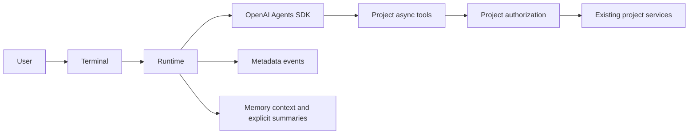

# Architecture and limits

`Project` is the small integration boundary: root, instructions, async `Tool`s, an
optional per-call policy and local commands. `run_cli(project, settings=None)` embeds
the terminal. `Runtime(...).run(...)` embeds the headless lifecycle; optional injected
SDK `Model` instances are for trusted integrations and deterministic protocol tests.

Only the SDK owns the inner model/tool loop. The runtime checks request/schema size,
model-call count, observed cumulative tokens, timeout, stream settlement and summary
commit. Streaming consumers are shielded; the SDK alone cancels its model loop.
Callback failures explicitly close the event iterator. The controller waits for both
consumer and run-loop cleanup before reporting a settled result. The terminal retains one
event loop for its entire session, displays interrupted outcomes before loop shutdown,
and blocks new model turns while previous runtime cleanup remains pending.

Async plugins must cooperate with cancellation. This package cannot forcibly terminate
Python code that blocks the event loop or ignores cancellation. `cleanup_incomplete`
means the outcome is interrupted; a malicious or indefinitely non-cooperative plugin
may also prevent Python process shutdown. Use OS isolation for untrusted workloads.

## Models and context

The first backend uses the OpenAI Agents SDK and Chat Completions or Responses APIs.
Other vendors require a compatible endpoint or their own tested SDK adapter. Naming a
model is not evidence of protocol compatibility. Python 3.13 and SDK 0.22.x are deliberate
initial boundaries, not claims of all Python/SDK/provider support.

`context_window` is application configuration. UTF-8 byte estimates are conservative
heuristics, not a provider tokenizer. Every model request checks system, input and tool
schema plus reserves. Summary generation has no tools, shares the execution budgets,
and only commits after successful cleanup and metadata settlement. Too-large material
fails explicitly; it is never silently discarded.

`max_session_tokens` settles usage when responses arrive, so a final request can overshoot.
Missing final usage after cancellation stays unknown and blocks subsequent requests under
a token cap. `/clear` never resets usage. Restoring a checkpoint restores its historical
usage snapshot, not an authoritative provider/account spending ledger. Price is unavailable;
no zero-cost or prepaid-budget guarantee is implied.

## State and privacy

State lives at `<project>/.agent-entry/`: metadata-only executions and immutable summary
checkpoints. The default conversation stays in memory. Only `/save` persists a summary,
not a transcript. Snapshots contain no tool grants or replay instructions. Scope is the
resolved absolute project path; moving a project invalidates old summary scope by design.
Project switch preflights config/plugin and clears context, queued messages and identity.

Metadata log writes fail closed. If a write tool fails or is cancelled, its result remains
unknown and no next model request is sent in that execution. There is no automatic write
replay or automatic rollback. Cross-process business recovery belongs to the project's
policy/services, not summary restoration.

The CLI currently targets macOS and Linux. Windows support is not implemented or verified.
