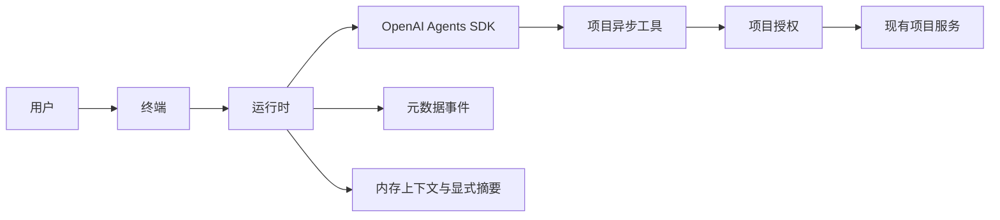

# 架构与限制

`Project` 是一个精简的集成边界，包含项目根目录、指令、异步 `Tool`、可选的逐次调用策略和本地命令。
`run_cli(project, settings=None)` 用于嵌入终端；`Runtime(...).run(...)` 用于嵌入无界面执行生命周期。
可选注入的 SDK `Model` 实例面向可信集成和确定性协议测试。

模型与工具的内部循环仅由 SDK 管理。运行时检查请求与 schema 大小、模型调用次数、已观测的累计 token、
超时、流式执行收尾以及摘要提交。流式消费者受到取消屏蔽保护，只有 SDK 负责取消其模型循环。
回调失败时会显式关闭事件迭代器。控制器会等待消费者、运行循环与真实工具调用任务都完成清理，再报告已完成收尾的结果。
终端在整个会话中保留同一个事件循环，在关闭循环前显示中断结果；只要前一次运行时清理仍未完成，
就会阻止发起新的模型轮次。

异步插件必须配合取消。对于阻塞事件循环或忽略取消的 Python 代码，本包无法强制终止。
`cleanup_incomplete` 表示结果处于中断状态；恶意或持续不配合的插件还可能阻止 Python 进程退出。
不可信工作负载应使用操作系统级隔离。

## 模型与上下文

首个后端使用 OpenAI Agents SDK，以及 Chat Completions 或 Responses API。
其他厂商需要兼容端点，或经过独立测试的 SDK 适配器。指定模型名称并不能证明协议兼容。
Python 3.13 和 SDK 0.22.x 是明确选定的初始支持边界，并不表示支持所有 Python、SDK 或模型提供方。

`context_window` 是应用配置。基于 UTF-8 字节数的估算是一种保守的启发式方法，并非模型提供方的分词器。
每次模型请求都会检查系统指令、输入、工具 schema 及预留空间。摘要生成不使用工具，与主执行共享预算，
并且只在清理和元数据收尾成功后提交。材料过大时会显式失败，不会静默丢弃。

`max_session_tokens` 在收到响应后结算用量，因此最后一次请求可能超出上限。
取消后若缺少最终用量，用量会保持未知；设置了 token 上限时，后续请求会被阻止。
`/clear` 从不重置用量。恢复检查点会恢复其中的历史用量快照，而不是权威的模型提供方或账户支出台账。
当前不提供价格信息，也不承诺零成本或预付预算保障。

## 状态与隐私

状态保存在 `<project>/.agent-entry/`，包含仅记录元数据的执行记录和不可变摘要检查点。
对话默认只保存在内存中。只有 `/save` 会持久化摘要，不会保存对话全文。
快照不包含工具授权或重放指令。作用域由解析后的项目绝对路径确定；按设计，移动项目会使旧摘要的作用域失效。
切换项目前会预检配置与插件，并清空上下文、排队消息和身份信息。

元数据日志写入失败时，执行会停止，不会继续放行。写工具失败或被取消后，其结果保持未知，
该次执行不会再发送下一个模型请求。系统不会自动重放写操作，也不会自动回滚。
跨进程的业务恢复由项目策略和服务负责，不属于摘要恢复的职责。

CLI 当前面向 macOS 和 Linux。Windows 支持尚未实现或验证。

## 执行观察与上下文准入

`Runtime.run(..., on_event=callback)` 通过允许字段的安全元数据副本通知界面；SDK 原始推理、工具载荷和异常正文不进入观察回调。回调失败会停止该观察者的通知，不影响业务执行。状态与耗时不构成私有思考链。

模型调用边界计算的窗口估算包含指令、输入和工具 schema。终端的 `/context` 显示已提交上下文组成与最近的实际准入估算；自动摘要阈值包含指令和 schema。摘要候选只在成功清理、账本结算后提交。SDK 仍是唯一的模型／工具循环拥有者。

普通模式使用可取消的异步 fd 行输入；会话期间统一处理 SIGINT，结束后恢复原处理器。增强模式采用相同的取消／退出策略。完整操作与持久化边界见[终端手册](terminal.md)。
