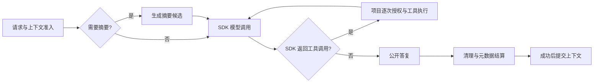

# 终端操作与执行状态

在仓库根目录设置模型和密钥环境变量后运行 `uv run --locked agent-entry`。无模型配置时仍可使用 `/help`、`/tools`、`/context`、`/usage` 查看本地信息；真正发起请求前必须配置模型与凭据。CLI 不自动加载 `.env`。

## 输入、停止和退出

| 场景 | 操作 | 行为 |
|---|---|---|
| 空闲 | Ctrl+C、空输入时 Ctrl+D、`/quit`、`/exit` | 退出，不自动保存 |
| 运行中 | Ctrl+C、Esc（增强模式）、`/stop` | 取消当前执行，等待模型与工具清理；下一轮队列暂停 |
| 正在取消 | 再次 Ctrl+C | 请求在现有清理结束后退出，不跳过清理 |
| 运行中 | `/quit`、`/exit`、空输入时 Ctrl+D | 取消并等待清理后退出 |
| 运行中 | 普通文字 | 放入下一轮队列；不修改已经发出的工具调用 |
| 增强输入 | Enter、Alt+Enter、上下键、Tab | 发送、插入换行、本次会话输入历史、命令补全 |

普通模式通过 `--plain` 启用；不创建阻塞的 `input()` 线程。增强模式显示动态状态与耗时；普通模式打印阶段事件，长时间等待时每 5 秒提示状态。`NO_COLOR=1` 关闭颜色。

退出不会自动执行 `/save`。不协作的可信插件仍可能阻止 Python 进程退出；“清理未完成”不表示外部操作已撤销，连续 Ctrl+C 也不会绕过这项事实。

## 可见执行流程



显式 `/compact`、`/save` 的摘要请求不调用业务工具；成功清理后才提交摘要。SDK 拥有唯一模型／工具循环，CLI 展示实际调用次数和上限，不另起一套 Agent loop。

界面会展示：

- 模型调用次数、请求窗口估算、等待／推理／公开答复输出阶段。
- 工具名称、读写声明、开始、完成、拒绝、失败或取消。读写声明不构成沙箱，也不表示已经授权。
- 摘要开始、候选生成、最终提交，取消与清理结果。
- 耗时、本轮已知／未知用量、未知写操作数量，以及执行 ID 和账本位置。

“模型推理中”只代表收到了对应的 SDK 事件类型；不展示推理正文，不把阶段名称当成模型内部思考。没有这类事件的兼容端点保持“等待响应”。公开答复照常流式显示。

## 常用命令

| 命令 | 用途 | 运行中可用 |
|---|---|---|
| `/help` | 内置及项目命令 | 是 |
| `/tools` | 工具名称、读写声明、授权策略是否配置 | 是 |
| `/status` | 当前阶段、耗时、循环与队列状态 | 是 |
| `/context` | 上下文组成、预留、剩余估算和压缩建议 | 是 |
| `/usage` | 累计已结算用量与本轮未结算部分 | 是 |
| `/model` | 查看生效配置 | 是；设置模型需空闲时使用 `/model NAME` |
| `/details` | 最近完成执行的安全元数据，不重复打印答复正文 | 是；当前执行查看 `/status` |
| `/queue` | 查看补充输入 | 是 |
| `/next`、`/drop` | 继续暂停的队列、丢弃队列 | 否 |
| `/compact` | 手动压缩上下文 | 否 |
| `/save` | 生成并显式持久化摘要 | 否 |
| `/sessions` | 按本地保存时间降序列出摘要 ID、UTC 时间和任务预览 | 否 |
| `/resume ID`、`/resume latest` | 恢复指定／最新有效的同项目摘要 | 否 |
| `/clear` | 清空短期上下文，保留累计用量 | 否 |
| `/project PATH` | 预检后切换项目，隔离上下文与执行状态 | 否 |

运行中的只读控制立即查看，不进入队列；其他控制命令会被拒绝，不会成为工具授权。项目自定义命令在空闲时执行，内置命令保持优先级。

## 上下文和用量怎么看

`/context` 的“已提交上下文”包括摘要及历史，并计算项目指令、工具 schema 和输出／系统预留。它不包含尚未发送的新输入。最近执行的“实际准入估算”来自模型调用边界，包含当次输入及 SDK 工具循环材料。两者并非同一个快照。

所有估算都以 UTF-8 字节为保守依据，不是供应商 tokenizer。每次模型请求仍独立检查完整材料和预算。自动压缩阈值也考虑指令及工具 schema，压缩失败保留原历史；无法装入窗口的材料不会静默删除。

`/usage` 的累计值只包括已结算执行；运行中单独显示已知部分，避免重复累加。取消后缺失的最终用量保持未知；设置 token 上限时，未知用量会阻止后续请求。上限在响应后结算，可能超额，不构成账户计费保证。恢复摘要会恢复历史用量快照。

## 常见故障

错误会显示固定安全原因码与中文处理建议，不输出供应商／插件异常正文。

| 原因码 | 处理 |
|---|---|
| `model_and_credential_required` | 设置模型和配置中指定的密钥环境变量 |
| `invalid_project_config` | 检查 `agent-entry.toml` 语法、字段、类型和窗口预留 |
| `provider_authentication_failed`、`provider_permission_denied` | 检查凭据和模型访问权限 |
| `provider_connection_failed`、`provider_timeout` | 检查端点、代理、网络和服务状态 |
| `provider_rate_limited`、`provider_quota_exceeded` | 等待服务恢复或核实额度；不会自动重试 |
| `model_call_budget_exceeded` | 检查工具循环与 `max_model_calls` |
| `invalid_summary_id`、`invalid_summary` | 使用 `/sessions` 选择本项目有效摘要，或 `/resume latest` |
| `write_result_unknown` | 到业务系统核实，不自动重放写操作 |
| `cleanup_incomplete` | 等待清理；检查不协作的项目插件 |

供应商错误分类依据 [OpenAI 官方错误文档](https://developers.openai.com/api/docs/guides/error-codes)，仅映射固定类别，不拼接异常正文。

## 嵌入式观察

```python
from agent_entry_cli import Runtime


async def run_with_progress(project, settings):
    events = []
    result = await Runtime(project, settings).run(
        "查询项目状态。",
        on_event=events.append,
    )
    return result, events
```

`on_event` 是同步观察回调，仅接收 SDK 外构造的安全元数据副本，不接收原始 SDK 事件。回调应快速返回；抛出异常后会停止通知该观察者，业务执行和元数据账本继续按原有规则收尾。不能用观察回调替代项目授权策略。

每条观察事件包含同一执行 ID 和单调时钟耗时，可与执行账本对应。阶段提示不会刷新跨文本分片的脱敏尾串。成功切换项目会清空增强编辑器的旧项目输入历史，失败切换保留原会话。

账本不包含原始消息、工具参数／结果、凭据或私有推理。摘要 `prepared` 表示候选已生成；仅成功的最终 `ended` 与上下文提交后通知表示生效。输入历史默认只在本次进程内保存，摘要也只有显式 `/save` 才落盘。
